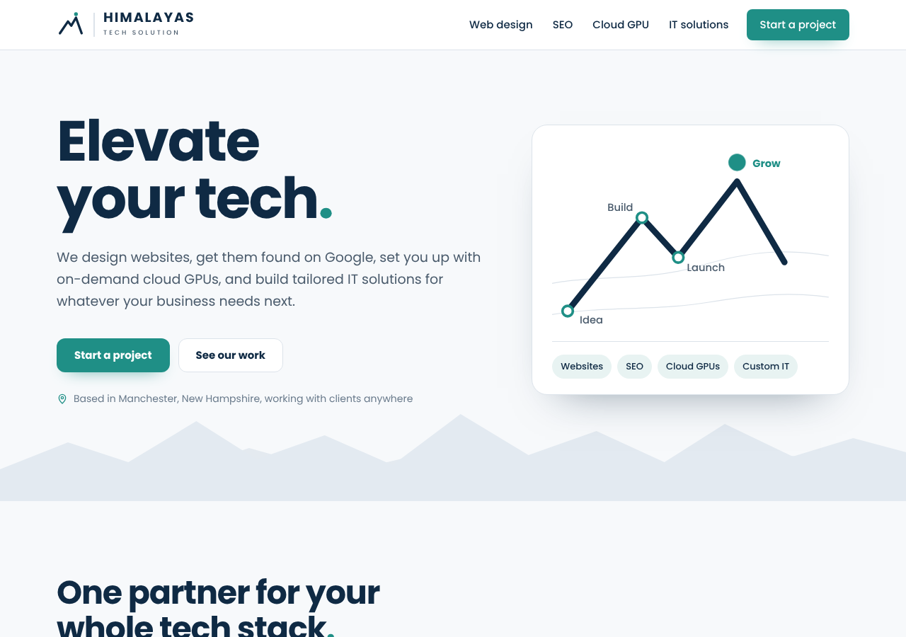
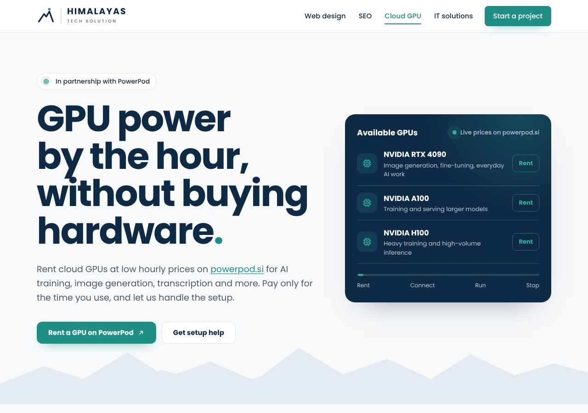

# Himalayas Tech Solution

**Elevate your tech.** The website and brand for [Himalayas Tech Solution](https://himalayastechsolution.com), a Manchester, New Hampshire studio for web design, SEO, cloud GPU (in partnership with [PowerPod](https://powerpod.si)) and tailored IT solutions.

**Live site:** https://himalayastechsolution.com

## What's here

| Folder | Contents |
|--------|----------|
| [`site/`](site) | The production website: five pages plus a 404 page, icons, sitemap and robots.txt |
| [`brand/`](brand) | Logo package: vertical and horizontal lockups, mark and app icons, in SVG and PNG, plus brand colors |
| [`deploy/`](deploy) | Nginx config and a step-by-step guide for hosting on an Ubuntu droplet |
| [`tools/`](tools) | Script that generates the logo files with text converted to outlines |

## Pages

- [Home](https://himalayastechsolution.com/)
- [Web design](https://himalayastechsolution.com/web-design/), with a portfolio of sites we've built
- [SEO](https://himalayastechsolution.com/seo/)
- [Cloud GPU](https://himalayastechsolution.com/cloud-gpu/)
- [IT solutions](https://himalayastechsolution.com/it-solutions/)

## How it's built

- Plain HTML, CSS and a little JavaScript, with no framework and no build step. Each page is a single file.
- Typeface: [Poppins](https://fonts.google.com/specimen/Poppins). Colors: Summit Navy `#0F2A44` and Glacier Teal `#1F8F86`.
- Light and dark themes follow the visitor's device setting.
- Works on phones, keyboard-accessible, and respects reduced-motion settings.
- SEO basics on every page: title, description, canonical URL, Open Graph sharing image, sitemap and business structured data.
- The "How we work" process is drawn as an elevation profile using real altitudes on Everest's standard route, from base camp at 5,364 m to the summit at 8,849 m.

## Portfolio

Websites designed and built by Himalayas Tech Solution:

- [hardevservices.org](https://hardevservices.org), human services, New Hampshire
- [omsewa.org](https://omsewa.org), human services, Hooksett, NH
- [himalayasonthebay.com](https://himalayasonthebay.com), a Nepali and Tibetan restaurant in South Portland, Maine, with online ordering

## Deploying

See [`deploy/DEPLOY-GUIDE.md`](deploy/DEPLOY-GUIDE.md). In short, copy `site/` to `/var/www/himalayastechsolution.com` on the server, add `deploy/nginx.conf` as an nginx site, and run Certbot for HTTPS.

## Contact

business@himalayastechsolution.com

---

© 2026 Himalayas Tech Solutions LLC. All rights reserved. The code is shared here as a portfolio piece; the logo, brand and copy belong to Himalayas Tech Solutions LLC.
